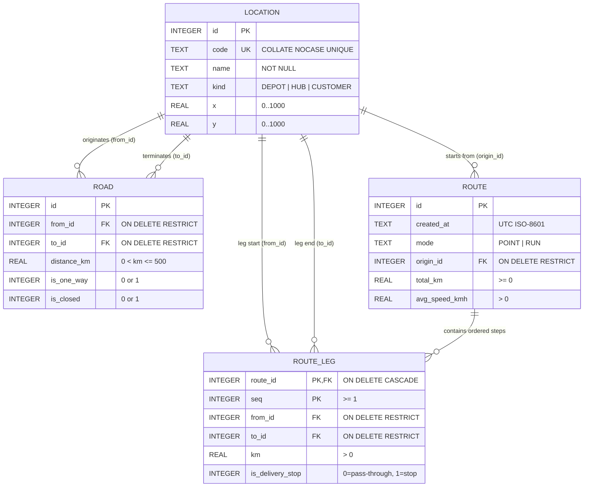

# RouteWise Database — Checkpoint 2 ERD (Active Routing & Persistence)

This diagram documents the active database model after completing Checkpoint 2 (`Issue #12`), activating `ROUTE` and `ROUTE_LEG` persistence on top of the Checkpoint 1 network model (`LOCATION` and `ROAD` in [er-diagram.md](er-diagram.md)).

## Version Progression (CP1 -> CP2)

1. **Checkpoint 1 (Network Foundation):** Only `LOCATION` and `ROAD` are populated and managed via `/api/locations`, `/api/roads`, and `/api/network/validation`. Two-way roads are normalized so `from_id < to_id`, with `UNIQUE(from_id, to_id)` and `from_id != to_id`.
2. **Checkpoint 2 (Route Planning & History Persistence):** `ROUTE` and `ROUTE_LEG` become active via `RouteRepository` and `RouteService` (`/api/routes/point`, `/api/routes/run`, `/api/routes`, `/api/routes/<id>`).
   - **Atomic Snapshot Persistence:** Creating a route inserts the `ROUTE` header and all its `ROUTE_LEG` rows inside a single `BEGIN IMMEDIATE` transaction.
   - **Immutable History:** Each saved leg stores the exact road step (`from_id`, `to_id`, `km`, `is_delivery_stop`) at planning time, so saved routes remain readable after application restarts and even if roads are later edited, closed, or deleted.
   - **Zero-Distance Self-Routes:** A `POINT` route with `origin_id == destination_id` records `total_km = 0.0` in `ROUTE` with zero `ROUTE_LEG` rows.
   - **Referential Integrity:** `PRAGMA foreign_keys = ON` is enforced on every connection; deleting any `LOCATION` referenced by `ROAD`, `ROUTE`, or `ROUTE_LEG` is restricted (`ON DELETE RESTRICT`), while deleting a `ROUTE` cascades to its `ROUTE_LEG` rows (`ON DELETE CASCADE`).
