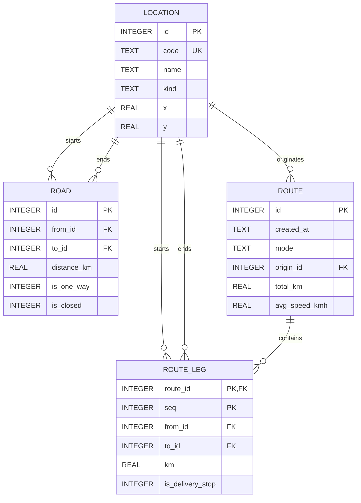

# RouteWise database

Road records have a unique ordered endpoint pair. Each two-way road is stored
once with the smaller location ID first. Deleting a route cascades to its
legs. References from roads, routes and legs restrict deletion of locations.
Routes and legs are part of the schema; the planning and history workflows
are implemented in later checkpoints.
